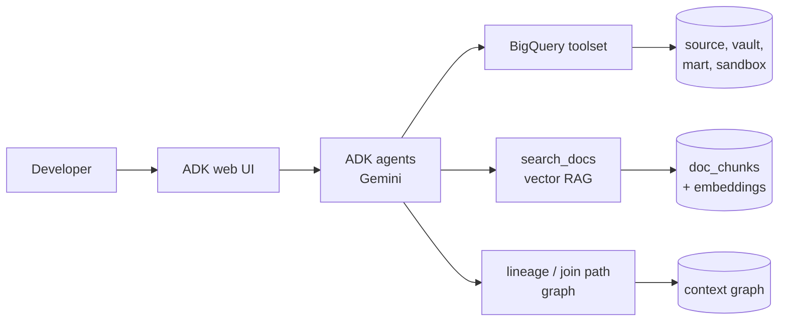

# ADK Agents with BigQuery Enterprise Context

A hands-on tutorial and working demo: Google **Agent Development Kit (ADK)** agents that use enterprise context stored in **BigQuery**, applied to the data engineering SDLC.

- **Vector RAG**: team standards, source specs, glossary and runbooks embedded with `ML.GENERATE_EMBEDDING` and searched with `VECTOR_SEARCH`.
- **Graph context**: lineage, declared join keys and business terms built from dbt's `manifest.json`, queried with **BigQuery Graph (GQL)** or a recursive-SQL fallback.
- **GraphRAG**: both together, turning business questions into correct SQL.
- **Applied use case**: a synthetic test data agent for a **dbt Data Vault**, with referential integrity, edge cases and automatic validation.

Runs on a laptop with `adk web` or on **Cloud Run** behind IAP, with the same code.



## Quick start

```bash
git clone https://github.com/gohils/zdbt-repo1.git && cd zdbt-repo1
python3 -m venv .venv && source .venv/bin/activate
pip install -r requirements.txt

gcloud auth application-default login
cp .env.example .env            # set GOOGLE_CLOUD_PROJECT, AGENT_MODEL, BQ_LOCATION

python setup/run_all.py         # datasets, fake data, dbt vault, graph, embeddings
cd agents && adk web            # open http://localhost:8000
```

Full instructions: **[docs/tutorial](docs/tutorial/README.md)**.

## Tutorial modules

| # | Module | Agent |
|---|---|---|
| 0 | [Prerequisites and setup](docs/tutorial/00-prerequisites-and-setup.md) | |
| 1 | [Base agent: BigQuery metadata and SQL](docs/tutorial/01-base-agent.md) | `base_agent` |
| 2 | [Vector RAG in BigQuery](docs/tutorial/02-vector-rag.md) | `rag_agent` |
| 3 | [Graph context: lineage, joins, impact](docs/tutorial/03-graph-context.md) | `graph_agent` |
| 4 | [GraphRAG: business question to SQL](docs/tutorial/04-graphrag.md) | `graphrag_agent` |
| 5 | [Synthetic Data Vault test data](docs/tutorial/05-synthetic-data.md) | `synthetic_data_agent` |
| 6 | [Evaluation](docs/tutorial/06-evaluation.md) | all |
| 7 | [Deploy to Cloud Run behind IAP](docs/tutorial/07-deploy-cloud-run.md) | all |

## Design

- [High-level design](docs/design/high-level-design.md): architecture, retrieval patterns, agent and tool design, security, cost, risks.
- [Data and graph model](docs/design/data-and-graph-model.md): source data, Data Vault, graph nodes and edges, document store.
- [Troubleshooting](docs/troubleshooting.md)

## Repository layout

```
de_context/      shared package: config, BigQuery helpers, tools, graph builder
agents/          one ADK agent per module (agent.py + prompt.md)
dbt_vault/       dbt Data Vault (staging, hubs, links, satellites) and marts
data/docs/       documents for vector search, by type
data/glossary.csv business terms mapped to columns (graph)
setup/           setup steps 00-05 and run_all.py
evals/           evaluation questions and runner
deploy/          Cloud Run deployment script
teardown/        remove everything
tests/           offline checks (pytest)
```

## Requirements

- A sandbox Google Cloud project with billing; rights to create BigQuery datasets and connections, and IAM bindings.
- Python 3.10+, gcloud CLI.
- BigQuery Graph (GQL) needs an edition with Graph support (Enterprise / Enterprise Plus reservation). Everything else, including the graph tools in `GRAPH_MODE=sql`, works on on-demand projects.

## Cost and safety

- Fake data only; small volumes. The full tutorial typically costs a few dollars or less.
- Every agent query has a `maximum_bytes_billed` cap and a job label.
- Agents are read-only, except the synthetic data agent, which can write only to `demo_sandbox` (IAM + a tool guard).
- `python teardown/teardown.py --yes --delete-connection` removes everything.

## Status

Built against ADK 2.x and dbt-core 1.12. The dbt project, graph builder, tools and agents are checked locally (parse, imports, unit-level checks); run the setup in your own project to validate end to end, and report issues.
