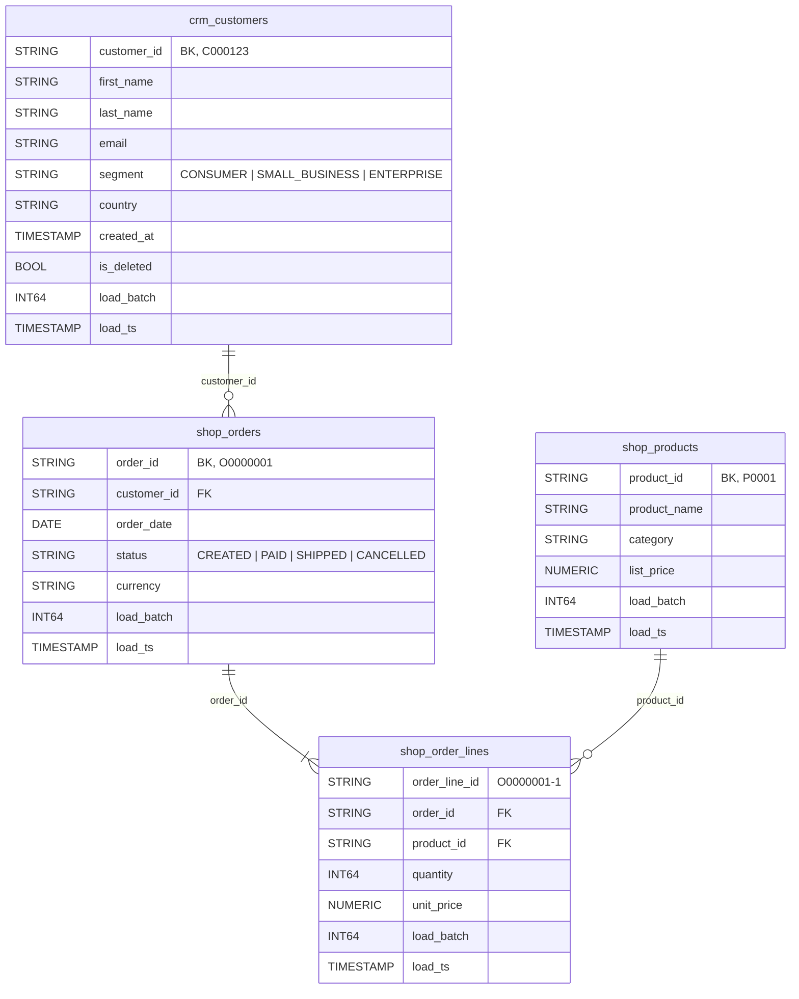
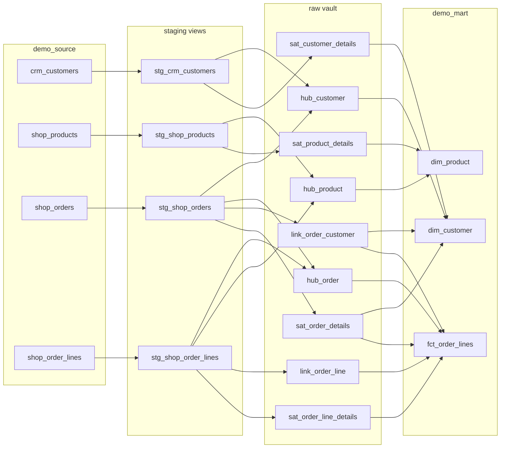
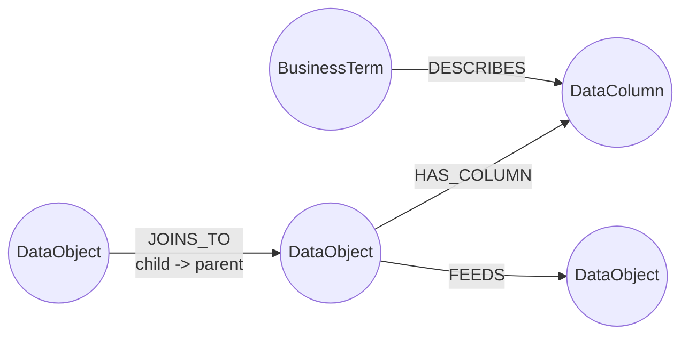

# Data and Graph Model

Reference for the tables the tutorial creates. All data is fake and deterministic (seed 42).

## 1. Source data (`demo_source`)

A small retail business with a CRM and a web shop, delivered in three load batches (`load_batch` 1-3, `load_ts` 2026-01-05, 2026-02-05, 2026-03-05).



| Table | Rows | What happens across batches |
|---|---|---|
| `crm_customers` | 493 | 300 → +60 → +40 new customers; 40 and 30 attribute updates; 10 and 8 unchanged reloads; 5 soft deletes |
| `shop_products` | 46 | 40 products; 6 price changes in batch 3 |
| `shop_orders` | 1,122 | 870 orders; status changes re-delivered in later batches |
| `shop_order_lines` | 2,576 | 1-5 lines per order, delivered once |

Expected vault sizes: `hub_customer` 400, `hub_order` 870, `hub_product` 40, `sat_customer_details` 475 (493 rows minus 18 unchanged reloads).

## 2. Data Vault (`demo_vault`) and marts (`demo_mart`)



Key rules (full text in `data/docs/standard/data_vault_standards.md`):

- Hash keys: `UPPER(TO_HEX(MD5(...)))` over trimmed, upper-cased values; NULL/blank → `^^`; `||` delimiter. Macros in `dbt_vault/macros/hashing.sql`.
- Hashdiffs: same rules, columns sorted alphabetically.
- Hubs: first-seen row per hash key from every source carrying the key (late-arriving customers from orders still get a hub row).
- Satellites: new row only when the hashdiff changes; unchanged reloads add nothing; duplicates in a batch collapse.
- Invalid (NULL/blank) business keys stay in staging (`is_valid_bk = FALSE`) and never reach the vault.

## 3. Context graph (`demo_context`)



| Table | Graph element | Key | Built from |
|---|---|---|---|
| `ctx_object` | Node `DataObject` | `object_id` (dbt unique_id) | sources and models in `manifest.json`; `layer` = source, staging, raw_vault, mart; `object_type` = source_table, staging_view, hub, link, satellite, dimension, fact |
| `ctx_column` | Node `DataColumn` | `column_id` = `object_id.column` | YAML columns (`data_type`, description) |
| `ctx_term` | Node `BusinessTerm` | `term_id` | `data/glossary.csv` |
| `ctx_feeds` | Edge `FEEDS` parent → child | `feed_id` | `depends_on.nodes` |
| `ctx_relationship` | Edge `JOINS_TO` child → parent | `relationship_id` | `relationships` tests (`column_name` → `field`) |
| `ctx_has_column` | Edge `HAS_COLUMN` | (`object_id`, `column_id`) | YAML columns |
| `ctx_describes` | Edge `DESCRIBES` | (`term_id`, `column_id`) | glossary `columns` list |

Current counts: 20 objects, 130 columns, 8 terms, 27 FEEDS, 13 JOINS_TO, 20 DESCRIBES.

Property graph DDL (GQL mode), generated by `de_context/graph_builder.py`:

```sql
CREATE OR REPLACE PROPERTY GRAPH demo_context.lineage_graph
  NODE TABLES (
    demo_context.ctx_object KEY (object_id) LABEL DataObject,
    demo_context.ctx_column KEY (column_id) LABEL DataColumn,
    demo_context.ctx_term   KEY (term_id)   LABEL BusinessTerm
  )
  EDGE TABLES (
    demo_context.ctx_feeds KEY (feed_id)
      SOURCE KEY (parent_id) REFERENCES ctx_object (object_id)
      DESTINATION KEY (child_id) REFERENCES ctx_object (object_id)
      LABEL FEEDS,
    demo_context.ctx_relationship KEY (relationship_id)
      SOURCE KEY (child_object_id) REFERENCES ctx_object (object_id)
      DESTINATION KEY (parent_object_id) REFERENCES ctx_object (object_id)
      LABEL JOINS_TO,
    demo_context.ctx_has_column KEY (object_id, column_id)
      SOURCE KEY (object_id) REFERENCES ctx_object (object_id)
      DESTINATION KEY (column_id) REFERENCES ctx_column (column_id)
      LABEL HAS_COLUMN,
    demo_context.ctx_describes KEY (term_id, column_id)
      SOURCE KEY (term_id) REFERENCES ctx_term (term_id)
      DESTINATION KEY (column_id) REFERENCES ctx_column (column_id)
      LABEL DESCRIBES
  );
```

Example GQL used by `get_lineage` (downstream, up to 5 hops):

```sql
GRAPH demo_context.lineage_graph
MATCH (start:DataObject {object_id: 'source.de_vault.crm.crm_customers'})-[e:FEEDS]->{1,5}(other:DataObject)
RETURN DISTINCT other.name AS name, other.dataset AS dataset,
       other.object_type AS object_type, other.layer AS layer
```

## 4. Document store (`demo_context.doc_chunks`)

| Column | Description |
|---|---|
| `chunk_id` | `<file>:<n>` or `catalog:<object_id>` |
| `doc_name` | Document title or `dataset.table` |
| `doc_type` | Folder under `data/docs` (`standard`, `source_spec`, `glossary`, `runbook`, `guide`) or `data_catalog` |
| `section` | `##` heading, or object type for catalog chunks |
| `content` | Title + heading + section text |
| `embedding` | `ARRAY<FLOAT64>` from the remote embedding model (`RETRIEVAL_DOCUMENT`) |

To add your own documents, drop markdown files into `data/docs/<doc_type>/` (use `##` headings) and re-run `python setup/run_all.py --from-step 5`.
