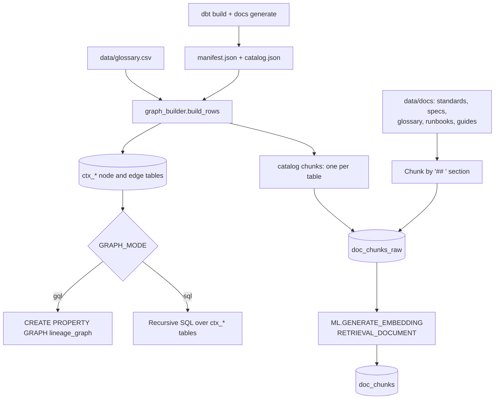
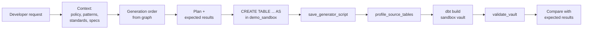

# High-Level Design: ADK Agents with BigQuery Enterprise Context

**Tutorial and demo: Vector RAG, graph context and GraphRAG for the data engineering SDLC**

| | |
|---|---|
| Status | Draft for review |
| Version | 0.2 |
| Audience | Data engineers, developers, architects |
| Run modes | Local laptop (`adk web`) and Cloud Run (behind IAP) |
| Repository | `gohils/zdbt-repo1` |

---

## 1. Overview

This document describes the design of a modular, hands-on tutorial that shows how agents built with Google's Agent Development Kit (ADK) use enterprise context stored in BigQuery:

- **Vector RAG** over unstructured documents (standards, source specs, glossary, runbooks, guides) and a generated data catalog, using BigQuery `ML.GENERATE_EMBEDDING` and `VECTOR_SEARCH`.
- **Graph context** over structured relationships (lineage, declared join keys, columns, business terms) built from dbt's `manifest.json`, queried with BigQuery Graph (GQL) or a recursive-SQL fallback.
- **GraphRAG**, combining both to turn natural-language questions into correct SQL and to ground engineering answers in the real model.

Everything is built around one fake retail dataset (CRM customers, web shop orders) and a small dbt Data Vault. The tutorial ends with an applied use case: a **synthetic test data generation agent** for Data Vault testing. The same code runs on a developer laptop or on Cloud Run; only configuration changes.

## 2. Goals and non-goals

### Goals
- Demonstrate vector RAG, graph context and GraphRAG with ADK and BigQuery in one coherent, progressive demo.
- Run identically on a laptop and on Cloud Run.
- Let a new developer complete setup and module 1 in under 30 minutes.
- Show measurable quality improvement as context is added (evaluation module).
- Produce reusable tools (`search_docs`, `get_lineage`, `find_join_path`, `get_column_context`) for real data engineering agents.

### Non-goals
- Production data or production deployment.
- A custom web UI (the ADK web UI is used throughout).
- CI/CD pipelines and multi-tenant access control.
- Deployment to Vertex AI Agent Engine (possible extension).

## 3. Architecture

### 3.1 Logical architecture

```mermaid
flowchart LR
    U[Developer] --> UI[ADK web UI]
    UI --> A[ADK agent<br/>Gemini model]

    subgraph Tools["Tools (de_context package)"]
        T1[BigQuery toolset<br/>metadata + SQL]
        T2[search_docs<br/>vector RAG]
        T3[get_lineage<br/>find_join_path<br/>get_column_context]
        T4[synthetic data tools<br/>generation order, profiling,<br/>vault validation]
    end

    A --> T1
    A --> T2
    A --> T3
    A --> T4

    subgraph BQ[BigQuery]
        S[(demo_source<br/>demo_vault<br/>demo_mart)]
        V[(doc_chunks<br/>+ embeddings)]
        G[(ctx_* node/edge tables<br/>+ property graph)]
        SB[(demo_sandbox<br/>demo_sandbox_vault)]
    end

    T1 --> S
    T1 --> SB
    T2 --> V
    T3 --> G
    T4 --> G
    T4 --> SB

    V -. ML.GENERATE_EMBEDDING .-> VX[Vertex AI<br/>embedding model]
```

### 3.2 Components

| Component | Responsibility |
|---|---|
| ADK agents (`agents/*`) | One agent per module. Reasoning, tool selection, response generation (Gemini, configurable). |
| ADK web UI | Chat, event and tool-call trace, session-based evaluation. |
| `de_context` package | Shared, pip-installable code: config, BigQuery helpers with cost caps, tools, prompt loading, graph builder. |
| BigQuery toolset | ADK first-party tools: `list_dataset_ids`, `get_dataset_info`, `list_table_ids`, `get_table_info`, `execute_sql`. Read-only (`WriteMode.BLOCKED`) except for the synthetic data agent. |
| `search_docs` | Fixed `VECTOR_SEARCH` query (cosine, top-k, optional `doc_type` filter). |
| `get_lineage` | Upstream/downstream traversal over `FEEDS` edges. |
| `find_join_path` | Shortest chain of declared relationships between two tables. |
| `get_column_context` | Tables containing a column, relationships and business terms. |
| Synthetic data tools | `get_generation_order`, `profile_source_tables`, `validate_vault`, `save_generator_script`, plus a `before_tool_callback` sandbox write guard. |
| dbt project (`dbt_vault/`) | Data Vault (staging, hubs, links, satellites) and marts; source of `manifest.json`. |
| Setup scripts (`setup/`) | Create datasets, load fake data, build vault, build context graph, embed documents. |
| Vertex AI | Gemini model for agents; embedding endpoint via a BigQuery remote model. |

### 3.3 Retrieval patterns

| Pattern | Example question | Flow |
|---|---|---|
| Vector RAG | "What are our hashing standards?" | question → embedding → `VECTOR_SEARCH` over `doc_chunks` → top chunks → grounded answer with citations |
| Graph context | "What breaks if `customer_id` changes?" | column/table → graph traversal → affected objects by layer → answer |
| GraphRAG | "Total order value of shipped orders by segment?" | glossary + catalog search → candidate tables → `find_join_path` → SQL → result with SQL and definitions |

```mermaid
sequenceDiagram
    participant D as Developer
    participant A as GraphRAG agent
    participant V as search_docs (vector)
    participant G as find_join_path (graph)
    participant B as BigQuery toolset

    D->>A: "Total order value of shipped orders by customer segment?"
    A->>V: glossary: "order value", "shipped order"
    V-->>A: line_amount = quantity * unit_price; status = SHIPPED
    A->>V: data_catalog: tables with segment and order value
    V-->>A: dim_customer, fct_order_lines
    A->>G: find_join_path(fct_order_lines, dim_customer)
    G-->>A: fct_order_lines.customer_hk = dim_customer.customer_hk
    A->>B: execute_sql (byte cap, read-only)
    B-->>A: rows
    A-->>D: result + SQL + definitions used
```

## 4. Data design

### 4.1 Datasets

| Dataset | Contents | Written by |
|---|---|---|
| `demo_source` | Fake source tables: `crm_customers`, `shop_products`, `shop_orders`, `shop_order_lines` (3 load batches) | setup step 2 |
| `demo_vault` | Staging views, hubs, links, satellites | dbt |
| `demo_mart` | `dim_customer`, `dim_product`, `fct_order_lines` | dbt |
| `demo_context` | `doc_chunks` (+ embeddings), `ctx_*` graph tables, embedding model, property graph | setup steps 4-5 |
| `demo_sandbox` | Synthetic source tables (7-day table expiry) | synthetic data agent |
| `demo_sandbox_vault` | Vault + marts built from synthetic data (7-day expiry) | dbt |

Details of every table and graph element: [data-and-graph-model.md](data-and-graph-model.md).

### 4.2 Context tables

| Table | Kind | Source |
|---|---|---|
| `doc_chunks` | Document and catalog chunks with `embedding` | `data/docs/<doc_type>/*.md`, one catalog chunk per table from the manifest |
| `ctx_object` | Node `DataObject` (source tables and dbt models) | `manifest.json` |
| `ctx_column` | Node `DataColumn` | `manifest.json` (YAML `data_type`), `catalog.json` fallback |
| `ctx_term` | Node `BusinessTerm` | `data/glossary.csv` |
| `ctx_feeds` | Edge `FEEDS` (parent → child lineage) | `depends_on` in the manifest |
| `ctx_relationship` | Edge `JOINS_TO` (child → parent, with join columns) | dbt `relationships` tests |
| `ctx_has_column` | Edge `HAS_COLUMN` | manifest columns |
| `ctx_describes` | Edge `DESCRIBES` (term → column) | glossary |

### 4.3 Context build pipeline



Notes:
- The remote embedding model uses a BigQuery Cloud resource connection whose service account has `roles/aiplatform.user`. Setup step 5 creates and grants it.
- Demo volumes are small (~70 chunks), so `VECTOR_SEARCH` runs brute force. A vector index (`CREATE VECTOR INDEX`) is only worthwhile for large corpora.
- Relationships that are not declared as dbt tests are invisible to the graph. This is intentional: it rewards declaring keys.

## 5. Agent design

### 5.1 Agents per module

| Module | Agent | Tools | Writes |
|---|---|---|---|
| 1 | `base_agent` | BigQuery toolset | none |
| 2 | `rag_agent` | + `search_docs` | none |
| 3 | `graph_agent` | BigQuery + `get_lineage`, `find_join_path`, `get_column_context` | none |
| 4 | `graphrag_agent` | all of the above | none |
| 5 | `synthetic_data_agent` | BigQuery, `search_docs`, `get_generation_order`, `get_column_context`, `profile_source_tables`, `validate_vault`, `save_generator_script` | `demo_sandbox` only |

Each agent is a folder with `agent.py` (defines `root_agent`) and `prompt.md`. Shared rules live in `de_context/common_rules.md` and are injected into every prompt.

### 5.2 Context placement

| Context | Where it lives |
|---|---|
| Environment, guardrails, workflow (short, stable) | Agent prompt (`prompt.md` + `common_rules.md`) |
| Standards, specs, glossary, runbooks, reviewed examples (long, unstructured) | `doc_chunks` (vector search) |
| Table descriptions and columns | `doc_chunks` with `doc_type = data_catalog` (vector) and `ctx_column` (graph) |
| Lineage, keys, term-to-column mapping (structured) | `ctx_*` tables / property graph |
| Live schemas and data | BigQuery toolset |
| Per-run scenario (volumes, batches, edge cases, seed) | Chat message |

### 5.3 Tool design principles
- **Fixed, validated queries.** Tools build SQL/GQL from fixed templates. Free-text inputs are query parameters; identifiers that must be inlined (GQL node keys) pass a strict allow-list check. The model never writes GQL.
- **Compact outputs.** Names, types, relationships and counts, not raw rows.
- **Clear docstrings.** ADK turns the signature and docstring into the tool definition; they tell the model when to use each tool.
- **Errors as data.** Tools return `{"status": "ERROR", "error_details": ...}` so the agent can correct itself.
- **Read-only by default.** Only the synthetic data agent gets `WriteMode.ALLOWED`, constrained by IAM and the `sandbox_write_guard` callback (one statement per call, qualified target in the sandbox dataset).

### 5.4 Graph modes

| | `GRAPH_MODE=gql` | `GRAPH_MODE=sql` |
|---|---|---|
| Lineage | `MATCH (start)-[e:FEEDS]->{1,N}(other)` | `WITH RECURSIVE` over `ctx_feeds` |
| Join path | Fixed 1-, 2-, 3-hop `JOINS_TO` patterns, shortest first | Breadth-first search over `ctx_relationship` |
| Requirement | BigQuery edition with Graph support (Enterprise / Enterprise Plus reservation) | Any project, including on-demand |

Both modes read the same node and edge tables, so results are equivalent.

## 6. Applied use case: synthetic data generation (module 5)

- Generates **source-layer** data in `demo_sandbox`; dbt builds `demo_sandbox_vault` from it, so hashing, hub loading and satellite change detection are tested for real.
- Uses `get_generation_order` (graph) to generate parents before children.
- Retrieves the synthetic data policy, the reviewed SQL patterns and the Data Vault standards (vector search) before generating.
- Writes SQL generators with deterministic randomness (`FARM_FINGERPRINT` + seed) and saves them with `save_generator_script`.
- States expected results before generating (hub rows, satellite rows, deliberate edge cases).
- Profiles the generated sources (`profile_source_tables`) and, after `dbt build`, validates the vault (`validate_vault`): hub key uniqueness, link-to-hub integrity, satellite-to-parent integrity, and no satellite row repeating the previous hashdiff.



## 7. Run modes and deployment

| Aspect | Local laptop | Cloud Run |
|---|---|---|
| Start | `cd agents && adk web` | `./deploy/deploy_cloud_run.sh group:<team>@<domain>` |
| Packaging | `pip install -r requirements.txt` (installs `de_context` editable) | Repository `Dockerfile` (built by Cloud Build via `gcloud run deploy --source .`), all agents in one service |
| Identity | Developer's own login (Application Default Credentials) | Dedicated service account `adk-de-agents-runner` |
| Access control | Local only | IAP on the Cloud Run service; access granted to a group |
| Configuration | `.env` | Env vars file generated from `.env` at deploy time |
| Audit | BigQuery jobs labelled `app=adk-bq-context-demo`, run as the developer | Jobs run as the service account; IAP logs show the user |

The shared `de_context` package is why a repository-level Dockerfile is used rather than `adk deploy cloud_run` (which packages a single agent folder).

## 8. Security and cost

### Security
- Fake data only; no production data in any demo dataset.
- Least privilege for the Cloud Run service account: `bigquery.jobUser`, `aiplatform.user`, `bigquery.connectionUser` at project level; `dataViewer` on demo datasets; `dataEditor` only on `demo_sandbox`.
- No service account keys anywhere; ADC locally, attached service account on Cloud Run.
- Cloud Run service not publicly reachable (`--no-allow-unauthenticated` + IAP).
- Sandbox write guard as a second line of defence after IAM.

### Cost
- `maximum_bytes_billed` on every agent and tool query (`MAX_BYTES_BILLED`, default 1 GB).
- Job labels for cost attribution in `INFORMATION_SCHEMA.JOBS`.
- Small volumes (a few thousand rows); sandbox tables expire after 7 days.
- `teardown/teardown.py` removes datasets, models, graph and (optionally) the connection.
- Recommended: a budget alert on the demo project.

## 9. Platform considerations

| Topic | Consideration | Mitigation |
|---|---|---|
| BigQuery Graph edition | GQL needs an edition/reservation that supports Graph | `GRAPH_MODE=sql` fallback; default in `.env.example` |
| GQL generation by LLMs | Models write GQL less reliably than SQL | Fixed, validated GQL in tools |
| Model availability | Gemini model IDs, regions and retirement dates change | `AGENT_MODEL`, `GOOGLE_CLOUD_LOCATION` in `.env` |
| Embedding endpoint | Endpoint must be available in the BigQuery location | `EMBEDDING_ENDPOINT` in `.env` |
| ADK versions | BigQuery toolset moved to `google.adk.integrations.bigquery` in ADK 2.x | `agent_kit.py` imports either path |
| ADK web UI | Developer tool, not an end-user product | Acceptable for this scope |

## 10. Repository structure

```
.
├── README.md
├── .env.example                  # all configuration
├── requirements.txt              # local install (incl. dbt, Faker, de_context)
├── pyproject.toml                # de_context package
├── Dockerfile / .dockerignore    # Cloud Run image (all agents)
├── de_context/                   # shared package
│   ├── config.py  bq.py  agent_kit.py  graph_builder.py  common_rules.md
│   └── tools/ doc_search.py  lineage.py  validation.py  sandbox_guard.py
├── agents/                       # one ADK app per module
│   ├── base_agent/  rag_agent/  graph_agent/  graphrag_agent/  synthetic_data_agent/
├── dbt_vault/                    # dbt Data Vault + marts
├── data/
│   ├── docs/<doc_type>/*.md      # standards, source specs, glossary, runbooks, guides
│   └── glossary.csv              # term -> columns (graph)
├── setup/                        # 00-05 + run_all.py
├── evals/                        # questions.yaml + run_evals.py
├── deploy/                       # deploy_cloud_run.sh, runtime requirements
├── teardown/                     # teardown.py
└── docs/
    ├── design/                   # this document, data and graph model
    ├── tutorial/                 # step-by-step modules 00-07
    └── troubleshooting.md
```

## 11. Tutorial modules

| # | Module | Outcome |
|---|---|---|
| 0 | Prerequisites and setup | Datasets, data, vault, graph and embeddings created by `setup/run_all.py` |
| 1 | Base agent | Agent answers questions with BigQuery metadata and SQL; sees its limits |
| 2 | Vector RAG | Answers grounded in team standards, specs and glossary, with citations |
| 3 | Graph context | Impact analysis, root cause and join paths from lineage |
| 4 | GraphRAG | Natural-language question to correct multi-table SQL |
| 5 | Synthetic data | Data Vault test data generated, loaded by dbt and validated |
| 6 | Evaluation | Same question set scored across modules 1-4 |
| 7 | Deploy | All agents on Cloud Run behind IAP |

## 12. Evaluation approach

- `evals/questions.yaml`: 12 questions covering standards, glossary, source specs, impact analysis, root cause, join paths, NL-to-SQL, onboarding and generation order.
- Each question has expected answer terms and expected tools. Transparent string checks, no LLM judge, so results are easy to inspect and discuss.
- `evals/run_evals.py` runs every question against each agent through the ADK runner and writes a comparison table to `evals/results/`.
- For conversational test cases, sessions can also be saved as eval sets in the ADK web UI.
- Success: clear improvement from `base_agent` to `graphrag_agent`.

## 13. Acceptance criteria

- A new developer completes setup and module 1 locally in under 30 minutes.
- Each module runs independently after setup.
- Module 5: synthetic data loads through the dbt vault with all `validate_vault` checks passing and row counts matching the stated expectations.
- Evaluation shows improvement from module 1 to module 4.
- All agents deploy to Cloud Run with one command and are reachable only through IAP.
- Teardown leaves no billable resources.

## 14. Risks and assumptions

| Risk / assumption | Impact | Mitigation |
|---|---|---|
| Project lacks a Graph-capable edition | GQL unavailable | `GRAPH_MODE=sql` |
| Vertex AI quota, region or model retirement | Setup or agent failures | Configurable model and location; troubleshooting guide |
| Connection IAM propagation delay | Embedding step fails at first | Automatic retries in step 5 |
| Agent generates costly queries | Unexpected spend | Byte cap, labels, budget alert |
| Agent writes outside the sandbox | Damaged demo tables | IAM + sandbox write guard |
| Keyword-based eval is coarse | Misleading scores | Keep questions specific; review answers in the report |
| Developers have BigQuery, Vertex AI and IAM rights in a sandbox project | Setup blocked otherwise | Prerequisite check (step 0) |

## 15. Roadmap

1. **Phase 1:** Modules 0-2 (works on any edition, immediate value).
2. **Phase 2:** Module 5 (pilot use case).
3. **Phase 3:** Modules 3-4 (graph and GraphRAG; GQL when an Enterprise reservation is available).
4. **Phase 4:** Modules 6-7 (evaluation and Cloud Run).
5. **Later:** Agent Engine deployment, MCP access to the tools, BigQuery Agent Analytics for agent observability, dbt generation agent using the same tools.

## 16. Open questions

- Which GCP project and BigQuery edition host the shared demo?
- Which Gemini and embedding models are approved?
- Which real standards documents can replace the fake ones in `data/docs`?
- Who owns maintenance of the tutorial repository?
