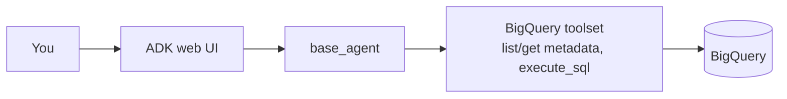

# Module 1: Base Agent (BigQuery metadata and SQL)

**Goal:** run your first ADK agent against BigQuery and see what an agent can and cannot do without enterprise context.
**Time:** 10 minutes.
**Agent:** `agents/base_agent`

## How it works



The whole agent is a few lines (`agents/base_agent/agent.py`):

```python
root_agent = Agent(
    name="base_agent",
    model=settings.agent_model,
    description="Answers questions about BigQuery data using only table metadata and SQL.",
    instruction=load_prompt(__file__),           # prompt.md + shared rules
    tools=[bigquery_toolset(allow_writes=False)],
)
```

`bigquery_toolset()` (in `de_context/agent_kit.py`) configures ADK's first-party BigQuery toolset with:
- your Application Default Credentials,
- `WriteMode.BLOCKED` (SELECT only),
- `maximum_bytes_billed` from `.env`,
- only the five core tools: `list_dataset_ids`, `get_dataset_info`, `list_table_ids`, `get_table_info`, `execute_sql`.

## Step 1: Start the ADK web UI

```bash
cd agents
adk web
```

Open http://localhost:8000 and select **base_agent** in the agent dropdown (top left).

> Running from the `agents` folder makes every subfolder an agent in the dropdown. Settings are read from the repo's `.env`.

## Step 2: Ask about the data

Try these:

1. `Which datasets and tables are available?`
2. `How many customers are there per segment in the current customer dimension?`
3. `Show the history of customer C000001 in the vault.`

Click an agent turn in the UI to open the **Events** panel. You will see each tool call (`list_table_ids`, `get_table_info`, `execute_sql`), its arguments (including the SQL) and the response. This trace is the main debugging tool for agents.

## Step 3: Find the limits

Now ask questions that need team knowledge:

4. `What hashing standard do we use for hash keys?`
5. `What is our definition of an active customer?`
6. `If I change the format of customer_id in crm_customers, what breaks?`

Typical behaviour:
- For 4, the agent can only guess from the data (it may inspect hash values) or answer from general knowledge. It cannot know your team's null token or the trim/upper rules.
- For 5, it may find `dim_customer.is_active` but cannot explain the 90-day rule.
- For 6, it has to guess lineage from table names.

That gap is what the next modules close: **documents** (module 2) and **relationships** (module 3).

## Step 4 (optional): Run from the terminal

```bash
cd agents
adk run base_agent
```

## What you learned

- An ADK agent is a model, an instruction and tools.
- The BigQuery toolset gives schema discovery and SQL with guardrails (read-only, byte cap).
- Without context, the agent knows *what data exists* but not *what it means* or *how it connects*.

## Checkpoint

- [ ] The agent answered questions 1-3 with correct SQL.
- [ ] You inspected tool calls in the Events panel.
- [ ] You noted where answers 4-6 were weak (compare after module 4).

Next: [Module 2: Vector RAG](02-vector-rag.md)
