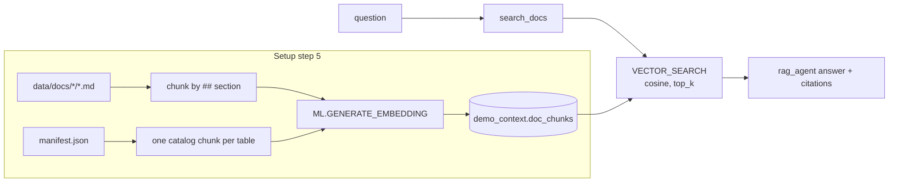

# Module 2: Vector RAG with BigQuery

**Goal:** give the agent your team's documents through vector search in BigQuery, and see answers become grounded and cited.
**Time:** 20 minutes.
**Agent:** `agents/rag_agent`

## How it works



Everything stays in BigQuery: the documents, their embeddings and the similarity search. No separate vector database.

## Step 1: Look at the documents

Browse `data/docs/`. The folder name is the document type:

| Folder (`doc_type`) | Examples |
|---|---|
| `standard` | Data Vault standards, dbt conventions, synthetic data policy |
| `source_spec` | CRM customers spec, web shop spec |
| `glossary` | Business glossary |
| `runbook` | Pipeline failure runbook |
| `guide` | Source onboarding, reviewed synthetic data SQL patterns |
| `data_catalog` | Generated: one chunk per table with its description and columns |

## Step 2: Look at the stored chunks

```sql
SELECT doc_type, doc_name, section, LEFT(content, 120) AS preview, ARRAY_LENGTH(embedding) AS dims
FROM demo_context.doc_chunks
ORDER BY doc_type, doc_name
LIMIT 20;
```

How they were created (from `setup/05_build_doc_embeddings.py`):

```sql
CREATE OR REPLACE MODEL demo_context.embedding_model
REMOTE WITH CONNECTION `PROJECT.US.vertex_conn`
OPTIONS (ENDPOINT = 'text-embedding-005');

CREATE OR REPLACE TABLE demo_context.doc_chunks AS
SELECT chunk_id, doc_name, doc_type, section, content,
       ml_generate_embedding_result AS embedding,
       ml_generate_embedding_status AS embedding_status
FROM ML.GENERATE_EMBEDDING(
  MODEL demo_context.embedding_model,
  (SELECT * FROM demo_context.doc_chunks_raw),
  STRUCT(TRUE AS flatten_json_output, 'RETRIEVAL_DOCUMENT' AS task_type));
```

## Step 3: Run a vector search yourself

This is the same query the `search_docs` tool runs (`de_context/tools/doc_search.py`):

```sql
SELECT base.doc_name, base.section, ROUND(distance, 4) AS distance
FROM VECTOR_SEARCH(
  TABLE demo_context.doc_chunks, 'embedding',
  (SELECT ml_generate_embedding_result AS embedding
   FROM ML.GENERATE_EMBEDDING(
     MODEL demo_context.embedding_model,
     (SELECT 'how do we treat nulls when hashing business keys?' AS content),
     STRUCT(TRUE AS flatten_json_output, 'RETRIEVAL_QUERY' AS task_type))),
  'embedding', top_k => 5, distance_type => 'COSINE')
ORDER BY distance;
```

The top result should be *Data Vault Modelling Standards - Hash keys*. Note the two task types: `RETRIEVAL_DOCUMENT` for stored chunks, `RETRIEVAL_QUERY` for the question.

## Step 4: See how the tool is exposed to the agent

`search_docs` is a plain Python function. ADK reads its signature and docstring to build the tool definition, so the docstring tells the model when to use it:

```python
def search_docs(question: str, doc_type: str = "", top_k: int = 5) -> dict:
    """Searches the team's documentation by meaning (vector search in BigQuery).

    Use this before answering questions about team standards, Data Vault rules,
    hashing, naming conventions, source system specs, business definitions, ...
    """
```

The agent adds it to its tools (`agents/rag_agent/agent.py`):

```python
tools=[bigquery_toolset(allow_writes=False), search_docs]
```

and its prompt (`agents/rag_agent/prompt.md`) tells it to search first and cite.

## Step 5: Ask the same questions as in module 1

In the web UI (`cd agents && adk web`), select **rag_agent**:

1. `What hashing standard do we use for hash keys?`
2. `What is our definition of an active customer?`
3. `How must a satellite handle a record that is reloaded with no changes?`
4. `Which order status transitions are allowed?`
5. `Which table should I use to report revenue by product category?` (uses `doc_type='data_catalog'`)

Compare with module 1. In the Events panel, check the `search_docs` call: the arguments (did it pick a `doc_type`?), the retrieved chunks and their distances.

## Step 6: Add your own document

1. Create `data/docs/standard/naming_standards.md` with a `# Title` and a few `## Section` headings.
2. Re-embed: `python setup/run_all.py --from-step 5`.
3. Ask the agent about it.

The `##` sections become chunks, so write one topic per section.

## Design notes

- **Chunking:** one chunk per `##` section, with the document title and heading prepended. Simple and predictable; good for standards-style documents.
- **Data catalog chunks:** table descriptions are embedded too, so "where is X?" questions work by meaning, not by table name.
- **Scale:** brute-force search is fine for hundreds or thousands of chunks. For larger corpora add `CREATE VECTOR INDEX ... ON demo_context.doc_chunks(embedding)`.
- **Freshness:** re-run step 5 whenever documents change (or schedule it).

## Checkpoint

- [ ] The vector search SQL returned the hashing section first.
- [ ] `rag_agent` answered questions 1-4 with citations to the documents.
- [ ] (Optional) Your own document was retrievable after re-embedding.

Next: [Module 3: Graph context](03-graph-context.md)
