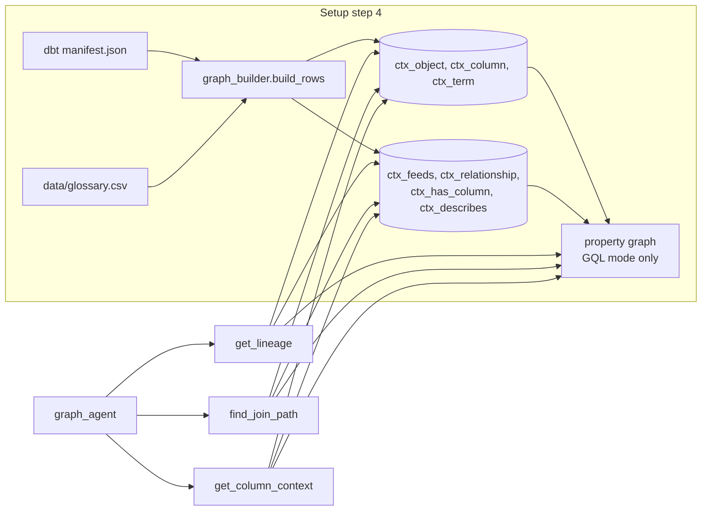

# Module 3: Graph Context with BigQuery (lineage, joins, impact)

**Goal:** give the agent the structure of your data platform (lineage, declared keys, business terms) as a graph in BigQuery, and use it for impact analysis, root cause analysis and join paths.
**Time:** 25 minutes.
**Agent:** `agents/graph_agent`

## How it works



The graph is built from dbt metadata you already have:

| Edge | Meaning | Comes from |
|---|---|---|
| `FEEDS` | model/source A is an input of model B | `depends_on` in `manifest.json` |
| `JOINS_TO` | child.column references parent.column | dbt `relationships` tests |
| `HAS_COLUMN` | table has column | YAML column definitions |
| `DESCRIBES` | business term describes column | `data/glossary.csv` |

## Step 1: Understand `manifest.json`

dbt writes `dbt_vault/target/manifest.json` on every `dbt parse`, `compile`, `run` or `build`. It holds every source, model, column, test and dependency. Look at one relationships test:

```bash
python -c "
import json
m = json.load(open('dbt_vault/target/manifest.json'))
t = [n for n in m['nodes'].values() if n['resource_type']=='test' and n['test_metadata']['name']=='relationships'][0]
print(t['test_metadata']['kwargs'])"
```

You will see `column_name`, `to` and `field`: exactly a foreign key. `de_context/graph_builder.py` turns these into `JOINS_TO` edges.

> A relationship only exists in the graph if it is declared as a dbt test. Declaring keys pays off twice: data quality and agent context.

## Step 2: Explore the graph tables

```sql
-- objects by layer
SELECT layer, object_type, COUNT(*) AS n
FROM demo_context.ctx_object GROUP BY 1, 2 ORDER BY 1, 2;

-- declared join keys
SELECT child_name, child_column, parent_name, parent_column
FROM demo_context.ctx_relationship ORDER BY child_name;
```

## Step 3: Traverse lineage

### SQL mode (any project)

`get_lineage` in `GRAPH_MODE=sql` runs a recursive query:

```sql
WITH RECURSIVE walk AS (
  SELECT child_id AS object_id, 1 AS hops
  FROM demo_context.ctx_feeds
  WHERE parent_id = 'source.de_vault.crm.crm_customers'
  UNION ALL
  SELECT f.child_id, w.hops + 1
  FROM walk w JOIN demo_context.ctx_feeds f ON f.parent_id = w.object_id
  WHERE w.hops < 5
)
SELECT o.name, o.layer, MIN(w.hops) AS hops
FROM walk w JOIN demo_context.ctx_object o USING (object_id)
GROUP BY 1, 2 ORDER BY hops, name;
```

### GQL mode (BigQuery Graph)

With `GRAPH_MODE=gql`, setup created a property graph (DDL in [data-and-graph-model.md](../design/data-and-graph-model.md)) and the same question is one pattern:

```sql
GRAPH demo_context.lineage_graph
MATCH (start:DataObject {object_id: 'source.de_vault.crm.crm_customers'})
      -[e:FEEDS]->{1,5}(other:DataObject)
RETURN DISTINCT other.name AS name, other.layer AS layer;
```

Join paths in GQL use undirected `JOINS_TO` patterns, shortest first:

```sql
GRAPH demo_context.lineage_graph
MATCH (a:DataObject {object_id: 'source.de_vault.shop.shop_order_lines'})
      -[r1:JOINS_TO]-(m:DataObject)
      -[r2:JOINS_TO]-(b:DataObject {object_id: 'source.de_vault.crm.crm_customers'})
RETURN r1.child_name, r1.child_column, r1.parent_name, r1.parent_column,
       r2.child_name, r2.child_column, r2.parent_name, r2.parent_column
LIMIT 1;
```

To switch an existing setup to GQL: set `GRAPH_MODE=gql` in `.env` and run `python setup/run_all.py --from-step 4 --to-step 4`. Both modes return equivalent results from the same tables.

## Step 4: Why the agent does not write GQL

The tools (`de_context/tools/lineage.py`) contain fixed queries. The agent passes only a table name, a direction and a hop limit; the tool resolves the name, validates identifiers and runs the query. Models are much less reliable at writing GQL than SQL, and fixed queries are cheap, predictable and safe.

## Step 5: Use the graph agent

`cd agents && adk web`, select **graph_agent**:

1. `If the customer_id column in crm_customers changes format, what is affected downstream?`
   Expect: `get_column_context('customer_id')` and/or `get_lineage('crm_customers', 'downstream')`, results grouped by layer (staging → hub_customer, link_order_customer, sat_customer_details → dim_customer, fct_order_lines).
2. `Which source tables does fct_order_lines depend on?` (upstream lineage)
3. `How do I join shop_order_lines to crm_customers?`
   Expect: `find_join_path` → `shop_order_lines.order_id = shop_orders.order_id`, `shop_orders.customer_id = crm_customers.customer_id`.
4. `Which columns describe the business term "customer segment"?` (`get_column_context('segment')`)
5. `Is there a declared path between hub_customer and dim_product?` (expect: no path; good test that the agent does not invent one)

## Design notes

- The graph is metadata-sized (tens to thousands of nodes), so queries are fast and cheap.
- Rebuild it whenever the dbt project changes: `python setup/run_all.py --from-step 4 --to-step 4` (run `dbt parse` first). In a team setup, run this in CI after merges.
- The same tables can hold more context later: owners, dashboards, SLAs, PII tags.

## Checkpoint

- [ ] You ran a lineage query in SQL (and GQL, if available).
- [ ] `graph_agent` produced a correct impact analysis and join path.
- [ ] Question 5 returned "no declared path" rather than a guess.

Next: [Module 4: GraphRAG](04-graphrag.md)
