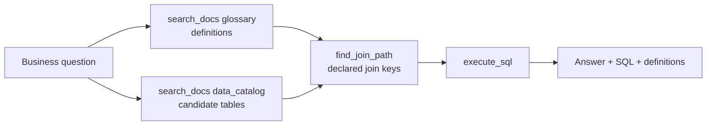

# Module 4: GraphRAG (vector search + graph together)

**Goal:** combine document search and graph traversal so the agent turns business questions into correct SQL, and engineering questions into answers grounded in the real model.
**Time:** 20 minutes.
**Agent:** `agents/graphrag_agent`

## The pattern

Vector search is good at *finding* the right starting points by meaning (a definition, a table that holds a concept). The graph is good at *connecting* them (how tables join, what depends on what). GraphRAG uses both:



The agent has all tools from modules 1-3 (`agents/graphrag_agent/agent.py`). Its prompt describes this workflow explicitly, so the order of tool calls is predictable.

## Step 1: Natural language to SQL

`cd agents && adk web`, select **graphrag_agent**, and ask:

1. `What is the total order value of shipped orders by customer segment?`

Watch the Events panel. A good run looks like:

| # | Tool call | What it contributes |
|---|---|---|
| 1 | `search_docs("order value shipped order", doc_type="glossary")` | Order value = `line_amount` (`quantity * unit_price`), excludes CANCELLED; shipped = status `SHIPPED` |
| 2 | `search_docs("customer segment and order value", doc_type="data_catalog")` | `demo_mart.dim_customer` (segment), `demo_mart.fct_order_lines` (line_amount, status) |
| 3 | `find_join_path("fct_order_lines", "dim_customer")` | `fct_order_lines.customer_hk = dim_customer.customer_hk` |
| 4 | `execute_sql(...)` | The result |

Expected SQL shape:

```sql
SELECT c.segment, SUM(f.line_amount) AS total_order_value
FROM `PROJECT.demo_mart.fct_order_lines` AS f
JOIN `PROJECT.demo_mart.dim_customer` AS c
  ON f.customer_hk = c.customer_hk
WHERE f.status = 'SHIPPED'
GROUP BY c.segment
ORDER BY total_order_value DESC;
```

The answer should also mention that amounts are in mixed currencies (from the glossary), a detail the base agent would miss.

2. `How many active customers do we have per country?`
   The glossary defines "active customer" and points to `dim_customer.is_active`.

## Step 2: Engineering questions

3. `A new billing source has a column cust_ref holding the CRM customer number, sometimes in lower case with spaces. Which hub should it load into and how is the key hashed?`
   Expect: onboarding guide + hashing standard (vector) and `get_column_context('customer_id')` / lineage of `hub_customer` (graph): load into `hub_customer`; MD5 of trimmed, upper-cased value; no new hub.

4. `I want to add a column to sat_customer_details. Which downstream models and tests are affected, and what standards apply?`
   Expect: `get_lineage('sat_customer_details', 'downstream')` and Data Vault standards on hashdiffs (the hashdiff changes when attributes are added).

## Step 3: Compare the agents side by side

Ask question 1 to **base_agent**, **rag_agent**, **graph_agent** and **graphrag_agent** (new session each time). Typical outcome:

| Agent | Typical answer |
|---|---|
| base_agent | Finds tables by name; may guess revenue definition and join keys; misses currency caveat |
| rag_agent | Knows the definitions; may guess the join |
| graph_agent | Correct join; no definitions |
| graphrag_agent | Correct definitions and joins, explains both |

Module 6 measures this systematically.

## Design notes

- **Tool order in the prompt.** Writing the workflow into the prompt makes behaviour more consistent than relying on tool docstrings alone.
- **Marts first.** The prompt prefers `dim_*`/`fct_*` for business questions; vault tables are for history and integration questions.
- **Keep tools small.** Each tool does one thing and returns compact output; the model composes them.

## Checkpoint

- [ ] Question 1 produced correct SQL using the declared join key.
- [ ] Question 3 recommended reusing `hub_customer` with the hashing rules.
- [ ] You compared at least two agents on the same question.

Next: [Module 5: Synthetic data generation](05-synthetic-data.md)
