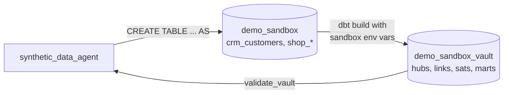

# Module 5: Synthetic Test Data for the Data Vault

**Goal:** use an agent to generate reproducible synthetic source data with referential integrity and Data Vault edge cases, load it through the real dbt vault, and validate the result.
**Time:** 30 minutes.
**Agent:** `agents/synthetic_data_agent`

## Why generate at the source layer

If test rows were written straight into hubs, links and satellites, hashing, hub loading and satellite change detection would never be tested. So the agent writes **source-shaped** tables into `demo_sandbox`, and the normal dbt project builds `demo_sandbox_vault` from them.



## What the agent uses

| Need | Tool | Context type |
|---|---|---|
| Policy, edge cases, reviewed SQL patterns, hashing rules | `search_docs` | Vector |
| Formats and value lists per source | `search_docs(doc_type='source_spec')` | Vector |
| Parents before children, foreign keys, columns | `get_generation_order` | Graph |
| Generate tables | `execute_sql` (writes allowed **only** in `demo_sandbox`) | BigQuery |
| Keep the generator | `save_generator_script` → `generated/*.sql` | Local file |
| Check sources | `profile_source_tables` | Fixed SQL |
| Check the vault | `validate_vault` | Fixed SQL |

### Guardrails

- The BigQuery toolset runs with `WriteMode.ALLOWED` for this agent only.
- `sandbox_write_guard` (a `before_tool_callback` in `de_context/tools/sandbox_guard.py`) blocks any write whose target is not `demo_sandbox`, multi-statement scripts, and statements other than CREATE/INSERT/UPDATE/DELETE/MERGE/DROP/TRUNCATE on tables.
- On Cloud Run, IAM gives the service account write access to `demo_sandbox` only (module 7).
- Sandbox tables expire after 7 days.

Try it: ask the agent to `drop table demo_vault.hub_customer`. The guard returns an error before anything reaches BigQuery.

## Step 1: Ask for a scenario

`cd agents && adk web`, select **synthetic_data_agent**, and send:

```
Generate synthetic source data for testing the customer and order part of the vault.
Seed 'seed-7', 2 load batches, 100 customers, 10 products, about 2 orders per customer
with 1-3 lines each. Include in batch 2: 10 customer attribute changes, 5 unchanged
reloads, 2 soft deletes, 1 exact duplicate row, 2 customer_ids with lower case and
spaces, 1 blank customer_id, and 1 order whose customer only arrives in batch 2.
```

## Step 2: Review the plan

Before generating, the agent should state expected results, for example:

| Expected | Value | Why |
|---|---|---|
| `hub_customer` rows | 100 + late-arriving + 0 for blank | Lower case / spaces hash to the same key; blank key excluded |
| `sat_customer_details` rows | 100 + 10 changes + 2 deletes | Reloads and the exact duplicate add nothing |
| Orphan orders at source | 0 after batch 2 | Late-arriving customer arrives in batch 2 |

If the plan is missing something, tell it before it generates. Getting the expected numbers written down first is what makes the test meaningful.

## Step 3: Let it generate

The agent will:
1. call `search_docs` for the policy, the SQL patterns guide and the hashing standard,
2. call `get_generation_order()` → `crm_customers`, `shop_products`, `shop_orders`, `shop_order_lines`,
3. run one `CREATE OR REPLACE TABLE PROJECT.demo_sandbox.<table> AS ...` per table,
4. save the full generator with `save_generator_script` (file in `generated/`),
5. run `profile_source_tables('demo_sandbox')` and compare with the plan.

Check the profile: null/blank keys, keys with case/whitespace variation, duplicates within batch, orphans and customers with changes should match what you asked for.

## Step 4: Build the sandbox vault with dbt

From the repo root:

```bash
set -a; source .env; set +a
cd dbt_vault
BQ_SOURCE_DATASET=demo_sandbox \
BQ_VAULT_DATASET=demo_sandbox_vault \
BQ_MART_DATASET=demo_sandbox_vault \
dbt build
cd ..
```

The same models now read from the sandbox. Source `relationships` tests run with severity `warn`, so deliberate orphans show as warnings instead of failing the build.

## Step 5: Validate

Back in the chat:

```
dbt build finished. Validate the sandbox vault and compare with your expected results.
```

The agent calls `validate_vault('demo_sandbox_vault')`, which checks:
- hub hash keys unique and not null,
- every link hash key exists in its hubs,
- every satellite key exists in its hub or link,
- no satellite row repeats the previous hashdiff (unchanged reloads stored = bug),

and returns row counts per hub, link and satellite to compare with the plan. All checks should pass and counts should match. If not, the difference tells you whether the generator or the vault logic is wrong; that is the point of the test.

## Step 6: Make it repeatable

- Open `generated/<name>.sql`, review it and commit it to your project.
- Re-run it any time with `bq query --use_legacy_sql=false < generated/<name>.sql` (split into statements if needed), or ask the agent to regenerate with another seed or volume.

## Try next

- `Generate a performance-size dataset: 50,000 customers, 3 batches, no edge cases.`
- `Add a scenario for order status transitions CREATED -> PAID -> SHIPPED across 3 batches.`
- Break something on purpose (edit `dbt_vault/models/raw_vault/sat_customer_details.sql` to remove the hashdiff comparison), rebuild the sandbox vault and see `validate_vault` catch it.

## Checkpoint

- [ ] The agent stated expected counts before generating.
- [ ] `demo_sandbox` has the four source tables; the generator is saved in `generated/`.
- [ ] `dbt build` on the sandbox succeeded.
- [ ] `validate_vault` passed and counts matched the plan.

Next: [Module 6: Evaluation](06-evaluation.md)
