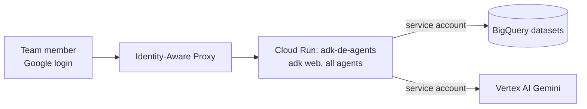

# Module 7: Deploy to Cloud Run (behind IAP)

**Goal:** run the same agents as a shared team service on Cloud Run, reachable only by your team.
**Time:** 15 minutes (most of it the first container build).

## What gets deployed



- One service, `adk-de-agents`, running `adk web` with all five agents in the dropdown.
- Built from the repository `Dockerfile` (the agents import the shared `de_context` package, so the image includes it).
- Runs as a dedicated service account with least-privilege roles.
- `--no-allow-unauthenticated` plus IAP: only members you grant can open it.

## Same code, different configuration

| | Laptop | Cloud Run |
|---|---|---|
| Identity | Your ADC login | Service account `adk-de-agents-runner` |
| Settings | `.env` | Env vars generated from `.env` at deploy time |
| Agent code | identical | identical |

## Step 1: Prerequisites

- Modules 0-5 setup done in the same project (datasets exist).
- Rights to enable APIs, create service accounts, grant IAM roles and deploy Cloud Run.
- For IAP with users outside a Google Workspace / Cloud Identity organisation, the OAuth consent screen may need configuring; see the IAP documentation.

## Step 2: Deploy

```bash
./deploy/deploy_cloud_run.sh group:data-eng@your-domain.com us-central1
```

(Use `user:you@your-domain.com` to grant just yourself.)

What the script does:

1. Enables Cloud Run, Cloud Build, Artifact Registry, IAP, Vertex AI and BigQuery APIs.
2. Creates the service account `adk-de-agents-runner` (if missing).
3. Grants project roles `bigquery.jobUser`, `aiplatform.user`, `bigquery.connectionUser` (needed for the embedding model in `search_docs`).
4. Grants `bigquery.dataViewer` on the demo datasets and `bigquery.dataEditor` **only** on `demo_sandbox`.
5. Writes the relevant `.env` values to an env vars file and runs:
   ```bash
   gcloud run deploy adk-de-agents --source . --service-account ... \
     --env-vars-file ... --no-allow-unauthenticated --iap
   ```
6. Lets the IAP service agent invoke the service (`roles/run.invoker`).
7. Grants your member `roles/iap.httpsResourceAccessor` on the service.

It prints the service URL at the end.

## Step 3: Use it

Open the URL in a browser signed in with an account that has access. You get the same ADK web UI as on your laptop. Run a few questions from earlier modules.

Check in the BigQuery console (Job history or `INFORMATION_SCHEMA.JOBS`) that queries now run as the service account and carry the label `app=adk-bq-context-demo`.

Note: module 5's `save_generator_script` writes to `/tmp/generated` inside the container, which is temporary. Copy generator SQL from the chat, or run module 5 locally.

## Step 4: Update after changes

Re-run the same script. It is idempotent: it rebuilds the image and redeploys a new revision.

## Step 5: Remove it

```bash
gcloud run services delete adk-de-agents --region us-central1
```

## Alternative: `adk deploy cloud_run`

ADK's own command deploys a single, self-contained agent folder:

```bash
adk deploy cloud_run --project PROJECT --region us-central1 --with_ui path/to/agent
```

This repo uses a Dockerfile instead because all agents share the `de_context` package and are deployed together. For an agent that has no shared code, `adk deploy cloud_run` is the quickest option.

## Checkpoint

- [ ] The service URL opens only for granted members.
- [ ] Agents answer the same as locally.
- [ ] BigQuery jobs show the service account as the user.

## Clean up the whole tutorial

```bash
gcloud run services delete adk-de-agents --region us-central1
python teardown/teardown.py --yes --delete-connection
```

Back to the [tutorial index](README.md).
